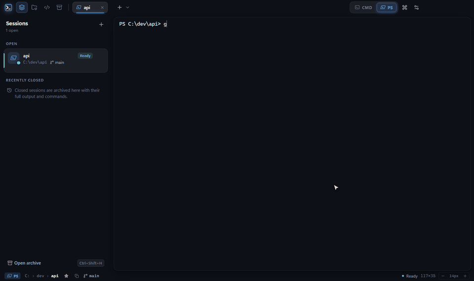
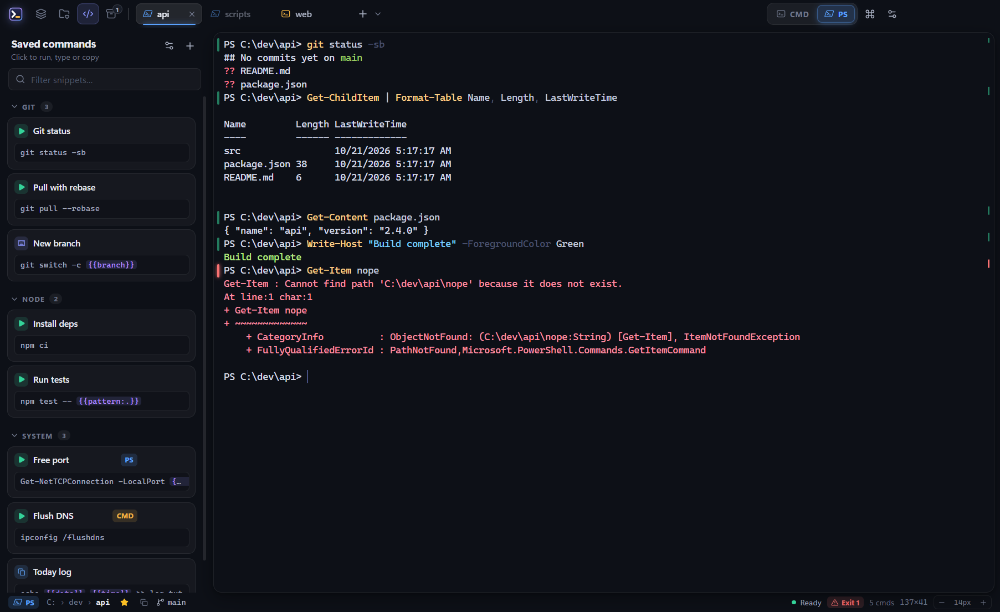
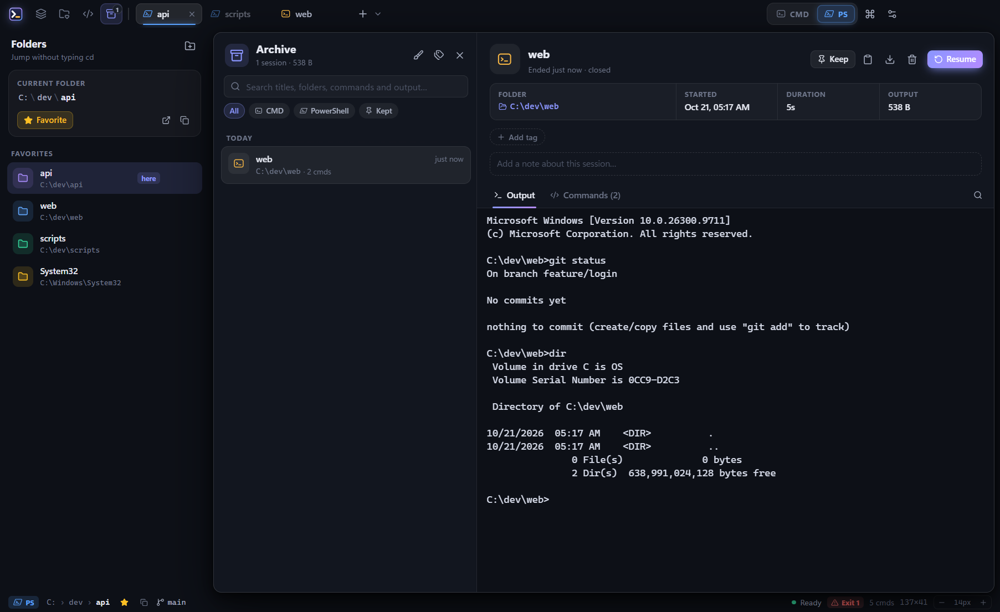
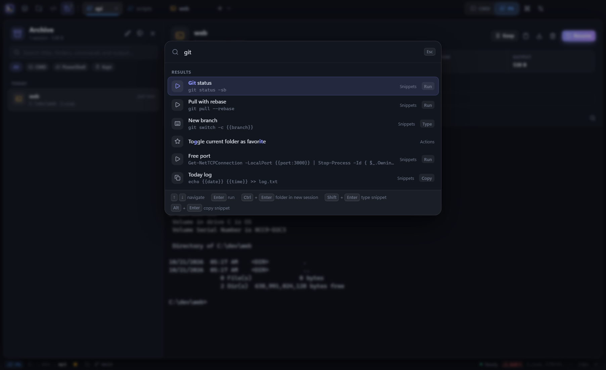
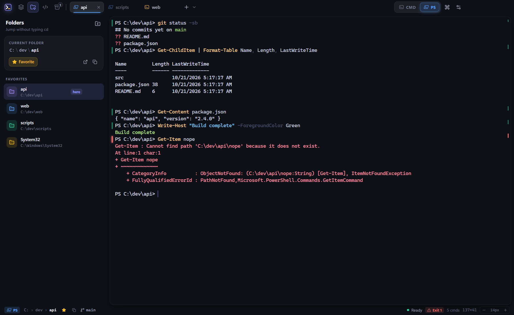
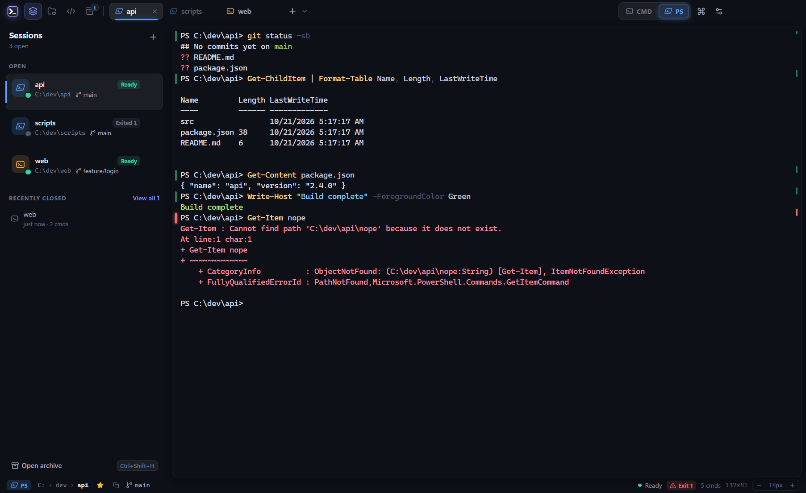
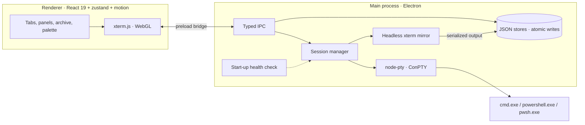

<div align="center">



<br>

[](https://github.com/alipkcode/Pro_Terminal/releases/latest)
[](https://github.com/alipkcode/Pro_Terminal/releases)
[](https://github.com/alipkcode/Pro_Terminal/stargazers)
[](#-install)
[](LICENSE)

[](https://www.electronjs.org/)
[](https://react.dev/)
[](https://www.typescriptlang.org/)
[](https://xtermjs.org/)
[](https://github.com/alipkcode/Pro_Terminal/actions/workflows/ci.yml)

**Your real `cmd.exe` and `powershell.exe`, with sessions, an archive, favorite folders and saved commands around them.**

[**⬇ Download for Windows**](https://github.com/alipkcode/Pro_Terminal/releases/latest) ·
[Features](#-features) ·
[Keyboard](#%EF%B8%8F-keyboard-shortcuts) ·
[Build from source](#-build-from-source) ·
[Changelog](CHANGELOG.md) ·
[Discussions](https://github.com/alipkcode/Pro_Terminal/discussions)

<br>



<sub>Run a command → run a saved command from the palette → fill a <code>{{placeholder}}</code> → jump to a folder with one click → find the closed session in the archive.</sub>

<br><br>

**If Pro Terminal saves you some typing, please consider giving it a ⭐. It helps other Windows users find it.**

</div>

<br>

## ✨ Why Pro Terminal?

Pro Terminal is not a new shell or an emulation layer. Each session is the **actual** `cmd.exe`,
`powershell.exe` or `pwsh.exe`, running through Windows' ConPTY exactly as it does in Windows Terminal.
Your scripts, aliases, profiles and tools all behave the same. Pro Terminal adds the workspace around them:

- **Nothing is lost.** Closed sessions go to a searchable archive with their full colored output and
  command history, and you can resume any of them in its original folder.
- **Less typing.** Jump to favorite folders in one click and run saved commands with smart placeholders.
- **Always clear.** Every session shows whether it is ready, running or exited, its folder, its git branch,
  and an exit-code mark next to every command.

## 🚀 Features

<table>
<tr>
<td width="50%" valign="top">

### 🗂 Sessions
Run many CMD and PowerShell sessions side by side, in tabs and in the Sessions panel, each with live
status, folder and git branch. Sessions are **restored on restart** with their previous output.

### ⇄ CMD ⇄ PowerShell switch
One switch in the top bar. On a blank session it swaps the shell in place. On one you've used, it
opens the other shell next to it instead.

### 🧠 Shell integration
Exit-code marks in the gutter, a per-command history, **Ctrl+↑/↓** to jump between commands, and live
folder tracking. It uses standard OSC 133/633 sequences and installs **nothing** into your profiles.

</td>
<td width="50%" valign="top">

### 🗄 Archive
Closed sessions keep their full output and commands. Search across titles, folders, commands and
output. Filter by shell, tag or *kept*. Rename, add notes, tag, keep (exempt from cleanup), export, or
**resume** a session in its original folder.

### ⭐ Favorite folders
One click moves the active session to a folder, with no `cd` to type. **Ctrl+click** opens a new
session there. Drag folders in from Explorer.

### ⌘ Command palette
**Ctrl+Shift+P** searches sessions, folders, snippets, the archive and every action, with fuzzy
matching.

</td>
</tr>
</table>

### 🧩 Saved commands (snippets)

Each snippet is set to **Run** (types it and presses Enter), **Insert** (types it so you can edit first) or
**Copy** (clipboard only), and can be limited to CMD or PowerShell.

| Placeholder | Becomes |
| --- | --- |
| `{{name}}`, `{{name:default}}` | Asks you for a value (remembers the last one) |
| `{{cwd}}` | The session's current folder |
| `{{clipboard}}` / `{{selection}}` | Clipboard text / selected terminal text |
| `{{date}}` / `{{time}}` | Today's date / the current time |

Group snippets, **drag groups to reorder** them, and choose whether each group starts expanded, collapsed
or as you last left it.

### ⚡ Shortcuts and folder actions (*new in 1.3.0*)

- **Shortcuts**: a folder, a shell and an optional script, one click away in the title bar. Add any of them
  to the desktop with the app icon recolored in its own color mood.
- **Folder actions**: save a script such as *"remove the dots from every name"* as a small `.exe` with its
  own icon. Drop it into any folder and open it there. It shows what it will do and asks first, then runs in
  that folder only or in every subfolder (deepest first). It runs in Pro Terminal, or in a console window on a
  PC without it.
- **17 ready-made folder scripts** under *Snippets › Folder actions*: clean up names, sort files by type,
  delete empty folders, extract zips, `git pull` every repository, and more.

<div align="center">


<br>


</div>

<div align="center">

</div>

### 🎨 Looks

10 terminal themes, light, dark and system app themes, **Mica** or **Acrylic** window backgrounds, a
GPU-accelerated (WebGL) renderer, and configurable font, cursor, line height and scrollback.

## 🩺 Start-up health check

Every launch opens a small splash window that checks the app before the main window appears. It takes
about half a second.

| Check | What it does |
| --- | --- |
| Windows & app files | ConPTY support (Windows 10 1809+), complete install, paths within Windows' 260-character limit |
| Data | Writable data folder. Settings, library and sessions files are validated, recovered after an interrupted save, or reset with a backup kept |
| Terminal engine | node-pty loads, shells are installed, and a real test shell starts through ConPTY (falls back to Windows' own ConPTY) |
| System | Free disk space, and whether the last session closed cleanly |

If something is repaired, you get a notice. If something blocks start-up, the splash explains it and
offers **Try again**, **Open data folder** and **Copy report**. The latest report is in
*Settings › About*.

## 📦 Install

1. Download **`Pro-Terminal-Setup-1.3.0.exe`** from the [latest release](https://github.com/alipkcode/Pro_Terminal/releases/latest).
2. Run it. It installs for your Windows user (**no admin rights needed**), lets you choose the folder and
   adds **Desktop** and **Start menu** shortcuts.

**Updating:** run the new installer. It upgrades the installed copy in place and keeps your settings, sessions,
favorites and snippets.

> [!NOTE]
> The installer isn't code-signed yet, so Windows SmartScreen may show *"Windows protected your PC"*.
> Choose **More info › Run anyway**. You can check the download against the SHA-256 listed in the release notes.

**Requirements:** Windows 10 version 1809 or later, or Windows 11 (x64). PowerShell 7 (`pwsh`) is used
when it's installed. Otherwise Windows PowerShell is used.

**Uninstall** from *Windows Settings › Apps*. Your sessions, favorites and snippets are kept in
`%APPDATA%\Pro Terminal\data`.

## ⌨️ Keyboard shortcuts

| Keys | Action |
| --- | --- |
| <kbd>Ctrl</kbd>+<kbd>Shift</kbd>+<kbd>P</kbd> | Command palette |
| <kbd>Ctrl</kbd>+<kbd>Shift</kbd>+<kbd>T</kbd> | New session (default shell) |
| <kbd>Ctrl</kbd>+<kbd>Shift</kbd>+<kbd>1</kbd> / <kbd>2</kbd> | New CMD / PowerShell session |
| <kbd>Ctrl</kbd>+<kbd>Shift</kbd>+<kbd>W</kbd> | Close session (it is archived) |
| <kbd>Ctrl</kbd>+<kbd>Tab</kbd> · <kbd>Ctrl</kbd>+<kbd>1</kbd>…<kbd>9</kbd> | Switch session |
| <kbd>Ctrl</kbd>+<kbd>Shift</kbd>+<kbd>F</kbd> | Find in terminal |
| <kbd>Ctrl</kbd>+<kbd>↑</kbd> / <kbd>↓</kbd> | Previous / next command |
| <kbd>Ctrl</kbd>+<kbd>Shift</kbd>+<kbd>E</kbd> / <kbd>S</kbd> / <kbd>H</kbd> | Folders / Snippets / Archive |
| <kbd>Alt</kbd>+<kbd>↑</kbd> / <kbd>↓</kbd> | Move the focused snippet group |
| <kbd>Ctrl</kbd>+<kbd>,</kbd> | Settings |

## 🛠 Build from source

Requires **Node.js 22+** and Windows.

```bash
git clone https://github.com/alipkcode/Pro_Terminal.git
cd Pro_Terminal
npm install
npm run dev
```

| Script | Does |
| --- | --- |
| `npm run dev` | Run with hot reload |
| `npm run typecheck` | Type-check the main and renderer code |
| `npm run build` / `npm start` | Bundle to `out/` / run the bundle |
| `npm run dist` | Windows installer (NSIS) in `dist/` |
| `npm run dist:dir` | Unpacked app in `dist/win-unpacked/` |
| `npm run icons` | Regenerate `icon.ico`/`icon.png` and installer art from `resources/*.svg` |

To build the installer without typing anything, double-click **`build-setup.bat`**. It installs the
dependencies when needed, checks the code, and builds `dist\Pro-Terminal-Setup-<version>.exe`. That file
installs Pro Terminal fresh or upgrades an existing installation.

Data lives in `%APPDATA%\Pro Terminal\data`. Set `PRO_TERMINAL_USER_DATA` to another folder to run a
separate profile (handy for testing).

## 🏗 How it's built



- **`src/main/pty`**: each session is a `node-pty` ConPTY process. A headless xterm mirror keeps the
  screen state, so sessions survive renderer reloads, and its serialized output becomes the archive log.
  Shell integration is injected through `PROMPT` (CMD) and a wrapped `prompt` function (PowerShell).
- **`src/main/store`**: JSON stores with atomic writes for settings, the library (favorites, snippets,
  tags) and archived sessions.
- **`src/main/health`**: the start-up checks and splash window.
- **`src/renderer`**: the UI. **`src/shared`** holds the types and IPC contract used by both sides.

## ❓ FAQ

<details>
<summary><b>How is this different from Windows Terminal?</b></summary>
<br>
Windows Terminal is an excellent terminal emulator. Pro Terminal runs the same shells through the same
ConPTY, and adds a <b>workspace</b> on top: a searchable archive of every closed session with its full
output, one-click favorite folders, saved commands with placeholders, per-command exit codes and history,
and a palette that searches all of it. If you mostly need tabs and panes, Windows Terminal is great. If
you keep losing output, retyping commands or <code>cd</code>-ing around, Pro Terminal is built for that.
</details>

<details>
<summary><b>Does it change my PowerShell profile or CMD settings?</b></summary>
<br>
No. Shell integration is injected only into the sessions Pro Terminal starts, through the
<code>PROMPT</code> variable (CMD) and a wrapped <code>prompt</code> function (PowerShell). Nothing is
written to your profiles or the registry.
</details>

<details>
<summary><b>Where is my data, and can I back it up?</b></summary>
<br>
Everything is plain JSON in <code>%APPDATA%\Pro Terminal\data</code>. You can also export and import
your favorites and snippets from <i>Settings › Archive &amp; data</i>.
</details>

<details>
<summary><b>Does it work with WSL, Git Bash or other shells?</b></summary>
<br>
Not yet. Pro Terminal focuses on CMD and PowerShell. Other shells are on the roadmap, so upvote or
comment in <a href="https://github.com/alipkcode/Pro_Terminal/discussions">Discussions</a> if you want
them.
</details>

## 🗺 Roadmap

- [x] Real CMD / PowerShell sessions, archive, favorites, snippets, palette
- [x] Installer and start-up health check
- [x] Reorderable snippet groups with start states
- [x] Shortcuts, desktop shortcuts and folder actions
- [ ] Split panes
- [ ] WSL and Git Bash sessions
- [ ] Auto-update
- [ ] `winget` package and a code-signed installer
- [ ] Portable (zip) build

Have an idea? [Start a discussion](https://github.com/alipkcode/Pro_Terminal/discussions/categories/ideas)
or open a [feature request](https://github.com/alipkcode/Pro_Terminal/issues/new/choose).

## 🤝 Contributing

Bug reports, ideas and pull requests are welcome. Issues labeled
[`good first issue`](https://github.com/alipkcode/Pro_Terminal/labels/good%20first%20issue) are a great
place to start. See [CONTRIBUTING.md](CONTRIBUTING.md) to get started, and [SECURITY.md](SECURITY.md) to
report a vulnerability privately.

## ⭐ Star history

<a href="https://star-history.com/#alipkcode/Pro_Terminal&Date">
  <picture>
    <source media="(prefers-color-scheme: dark)" srcset="https://api.star-history.com/svg?repos=alipkcode/Pro_Terminal&type=Date&theme=dark">
    
  </picture>
</a>

## 📄 License

[MIT](LICENSE) © 2026 alipkcode

<div align="center">
<sub>Built for people who live in CMD and PowerShell.</sub>
</div>
